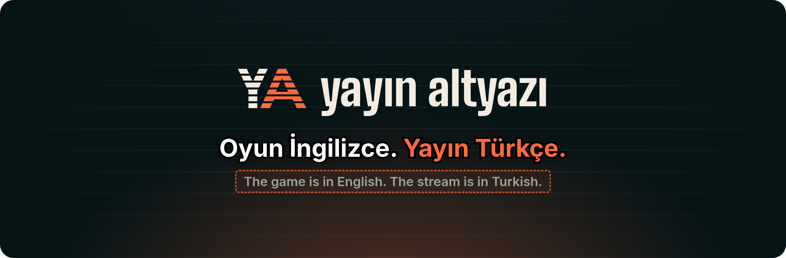
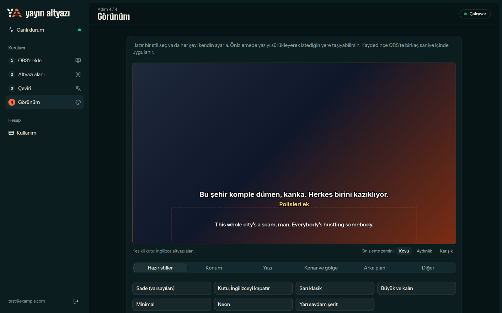
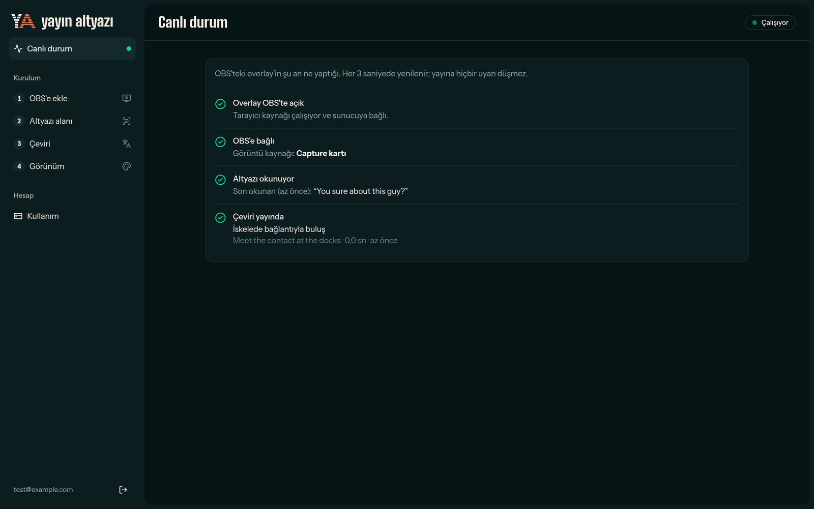
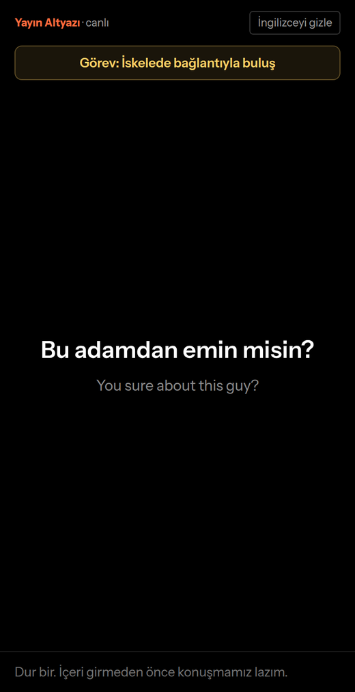
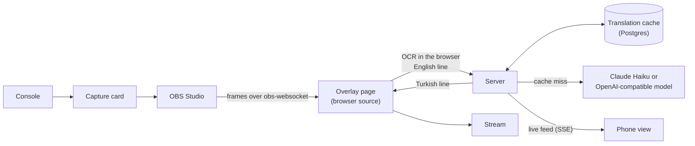

<div align="center">



<h3>Live Turkish subtitles for console game streams</h3>

<p>An OBS overlay that reads the game's English subtitles from your capture card<br />and puts natural Turkish on stream, usually within a second.</p>

<p>
  <a href="LICENSE"></a>
  
  
  
  
</p>

<p>
  <b>English</b> · <a href="README.tr.md">Türkçe</a>
</p>

<p>
  <a href="https://altyazi.ordinon.com"><b>Hosted version</b></a> ·
  <a href="#features">Features</a> ·
  <a href="#how-it-works">How it works</a> ·
  <a href="#quick-start">Quick start</a> ·
  <a href="#deploy">Deploy</a> ·
  <a href="#configuration">Configuration</a> ·
  <a href="#faq">FAQ</a>
</p>

</div>

<br />

<p align="center">
  
</p>

## Why

Big games ship without Turkish, and console streamers can't install mods or subtitle patches. Yayın Altyazı works from the video alone. It reads the English subtitles the game already draws, translates them with the conversation as context, and draws the Turkish line on top of the game in OBS. Nothing touches the console or the game.

It started with GTA 6 and ships a glossary for it. It works with any game that shows English subtitles.

## Hosted version

Don't want to run a server? **[altyazi.ordinon.com](https://altyazi.ordinon.com)** is the hosted version, ready to use with a free trial. Sign up, paste the overlay link into OBS and go live. This repository is the same project with the code open, for anyone who wants to read it, run it on their own server or contribute.

## Features

<table>
  <tr>
    <td width="50%" valign="top">
      <h4>Video stays on the streamer's PC</h4>
      Tesseract runs as WebAssembly inside OBS's browser source. Only the English text it reads goes to the server.
    </td>
    <td width="50%" valign="top">
      <h4>Dialogue and objectives, separately</h4>
      The reader tells the dialogue apart from the mission objective line under it. Each gets its own line, color and size on stream.
    </td>
  </tr>
  <tr>
    <td valign="top">
      <h4>Context-aware translation</h4>
      Each line goes to the model with the last few lines of the scene, so pronouns, slang and running jokes come out right. A game glossary keeps names as they are.
    </td>
    <td valign="top">
      <h4>Shared translation cache</h4>
      A translated line is stored once and served instantly to everyone after that. Trigram matching (<code>pg_trgm</code>) also catches OCR typos of lines already in the cache.
    </td>
  </tr>
  <tr>
    <td valign="top">
      <h4>Full style control</h4>
      Font, size, color, outline, shadow, box and position, with presets and a live preview. The "cover" mode draws an opaque box exactly over the English text.
    </td>
    <td valign="top">
      <h4>Phone and second-screen view</h4>
      A separate link (with QR code) shows the Turkish lines live on a phone, a tablet or an OBS dock, so the streamer can read along while looking at the TV.
    </td>
  </tr>
  <tr>
    <td valign="top">
      <h4>Live status in the dashboard</h4>
      Shows whether the overlay is open, OBS is connected, what OCR last read and what was last translated. Problems show up there, never on stream.
    </td>
    <td valign="top">
      <h4>Your model, your server</h4>
      Claude Haiku by default, or any OpenAI-compatible API, local models included. One Docker image, Postgres or embedded PGlite.
    </td>
  </tr>
</table>

<table>
  <tr>
    <td width="72%"></td>
    <td width="28%"></td>
  </tr>
  <tr>
    <td align="center"><sub>Live status in the dashboard</sub></td>
    <td align="center"><sub>Phone view</sub></td>
  </tr>
</table>

## How it works



1. The streamer opens the dashboard, picks the capture source and marks where the subtitles appear.
2. The overlay page (`/o/<token>`) runs inside OBS as a Browser Source. It talks to OBS's built-in obs-websocket on `ws://127.0.0.1:4455` and grabs frames of the capture source.
3. The reader finds light text in the subtitle area, measures how bright it really is, and reads it with Tesseract. A line goes out as soon as it's first read and is confirmed on the next frames, so translation starts early.
4. The server checks the cache, then asks the model with the scene so far as context. It checks each reply and drops one that comments on the input instead of translating it.
5. The overlay draws the Turkish line in the chosen style. The phone view gets it at the same time.

## Quick start

You need **Node.js 24** and **pnpm 11**, plus an Anthropic API key or any OpenAI-compatible API.

```sh
git clone https://github.com/berkay-digital/yayin-altyazi.git
cd yayin-altyazi
pnpm install
cp .env.example .env
```

Fill in `BETTER_AUTH_SECRET` (`openssl rand -base64 32`) and `ANTHROPIC_API_KEY` in `.env`. To use another model instead, set `AI_BASE_URL`, `AI_API_KEY` and `AI_MODEL`.

```sh
pnpm dev
```

Open http://localhost:3000, create an account and follow the four setup steps in the dashboard. Development uses PGlite (embedded Postgres) in `.data/pglite`, so there's no database to set up. Migrations run on startup.

### Setting up OBS

1. In OBS, open **Tools → WebSocket Server Settings** and turn the server on.
2. In the dashboard, copy the overlay link from **OBS'e ekle** and add it to your scene as a **Browser** source, 1920 × 1080, above the game.
3. In **Altyazı alanı**, enter the WebSocket password, pick the capture card or game input (not a scene) and check the box around the subtitles.
4. Turn on English subtitles in the game. The **Canlı durum** page shows each step turning green.

The streamer needs OBS Studio 28 or newer and a capture card. Streamlabs isn't supported.

## Deploy

The Dockerfile builds a Node server (Nitro `node-server` output) that listens on port 3000.

```sh
docker build -t yayin-altyazi .
docker run -d -p 3000:3000 --env-file .env yayin-altyazi
```

For production:

- Set `DATABASE_URL` to Postgres. The migrations create the `pg_trgm` extension, so the database user needs permission for that. Without `DATABASE_URL` the container falls back to PGlite in `/app/.data/pglite`; mount a volume there if you go that way.
- Set `BETTER_AUTH_URL` to the public https address. OBS's browser can still reach `ws://127.0.0.1` from an https page.
- Set `SIGNUP=closed` once your own account exists. Every account can spend your API key.
- Behind Cloudflare, set `CLIENT_IP_HEADER=cf-connecting-ip` so rate limits see the real client address.

`/api/health` returns 200 when the database answers and the translation backend is ready.

> [!NOTE]
> Regular Chrome asks for permission before a website can reach `127.0.0.1`. If the dashboard can't see OBS, allow local network access for the site, or open the dashboard as an OBS custom dock.

## Configuration

Everything is set through environment variables. [`.env.example`](.env.example) lists them all with notes.

| Variable | Required | What it does |
| --- | --- | --- |
| `BETTER_AUTH_SECRET` | yes | Signs sessions. A random string of 32+ characters. |
| `BETTER_AUTH_URL` | yes | Public address of the app. |
| `ANTHROPIC_API_KEY` | one backend | Claude key for translation. |
| `ANTHROPIC_API_KEY_PRIMARY` | | Second key that serves first. `ANTHROPIC_API_KEY` takes over while it is rate limited or out of credit. |
| `CLAUDE_MODEL` | | Defaults to `claude-haiku-5-5`. |
| `AI_BASE_URL` `AI_API_KEY` `AI_MODEL` | one backend | OpenAI-compatible API, used when no Anthropic key is set. Local servers work. |
| `AI_EXTRA_BODY` | | JSON merged into each chat completion request, such as `{"temperature":0.2}`. |
| `DATABASE_URL` | production | Postgres. Unset means PGlite in `PGLITE_DIR` (default `.data/pglite`). |
| `SIGNUP` | | `closed` stops new accounts. |
| `CLIENT_IP_HEADER` | | Header your proxy puts the client address in. Default is `X-Forwarded-For`. |
| `TURNSTILE_SITE_KEY` `TURNSTILE_SECRET_KEY` | | Cloudflare Turnstile on sign-up and sign-in. |
| `SUPPORT_EMAIL` | | Shown on the sign-in page for password resets. The app sends no email. |

<details>
<summary><b>Optional billing with Polar</b></summary>
<br />

Billing is off by default, and every account translates without limits. To charge for a hosted instance, create a monthly product in [Polar](https://polar.sh) and set:

| Variable | What it does |
| --- | --- |
| `POLAR_ACCESS_TOKEN` | Polar API token. Billing turns on when this and `POLAR_PRODUCT` are set. |
| `POLAR_PRODUCT` | Product id of the monthly plan. |
| `POLAR_WEBHOOK_SECRET` | Webhook secret. Point the webhook at `/api/auth/polar/webhooks` with the `subscription.*` events. |
| `POLAR_ENV` | `production` for live payments. Defaults to `sandbox`. |
| `PLAN_NAME` `PLAN_PRICE` | What the dashboard shows, such as `Aylık` and `₺99/ay`. |
| `TRIAL_MINUTES` | Free trial length. Default 180. |
| `FAIR_USE_MINUTES` | Monthly cap of the paid plan. Default 15000. |

Usage counts in active minutes: a minute counts only when at least one line was delivered in it, so menus, driving and chatting are free.

</details>

## Development

```sh
pnpm dev          # http://localhost:3000
pnpm typecheck
pnpm lint
pnpm build
pnpm test:e2e     # builds, then runs the end-to-end suite
```

After schema changes, run `pnpm drizzle-kit generate --name <name>`. `/dev/engine` is an OCR test page: load a video or screenshot and see what the reader sees.

```
src/
├── engine/        OCR in the browser: frame sources, preprocessing, Tesseract, SubtitleReader
├── server/        auth, translation and cache, metering, live hub, glossaries
├── routes/        landing, auth, dashboard, overlay (/o/$token), phone view (/v/$viewToken), API
├── components/    dashboard, overlay and landing UI (shadcn/ui on Base UI)
└── shared/        settings schema shared by browser and server
scripts/
├── ocr-bench/     OCR benchmark on real gameplay footage
├── prefill/       fills the cache ahead of time from a playthrough video
└── eval-models.ts compares translation models
tests/             end-to-end suite (e2e), its fixtures and the test server
drizzle/           SQL migrations, applied on startup
```

Built with [TanStack Start](https://tanstack.com/start), [React 19](https://react.dev), [Tailwind CSS 4](https://tailwindcss.com), [shadcn/ui](https://ui.shadcn.com), [Better Auth](https://better-auth.com), [Drizzle](https://orm.drizzle.team), [Tesseract.js](https://tesseract.projectnaptha.com) and [obs-websocket-js](https://github.com/obs-websocket-community-projects/obs-websocket-js).

### End-to-end tests

The suite in [`tests/`](tests) runs on [e2e](https://e2e.com) (Playwright underneath) against the production build. [`tests/support/serve.mts`](tests/support/serve.mts) starts the app on a free port with a throwaway database and a mock translation model, so it needs no API key and never calls a paid model. It covers:

- the landing page, sign-up, sign-in and sign-out
- the dashboard's setup steps, saving a style and replacing the overlay links
- the line API, the translation cache and early reads
- the whole subtitle path: the overlay reads [`tests/fixtures/subtitles.webm`](tests/fixtures) (invented English lines) with OCR in the browser, and the Turkish line shows on the overlay, the phone view and the live status

```sh
pnpm test:e2e                          # build and run everything
pnpm exec e2e run tests/panel.e2e.ts   # one file, against the last build
pnpm exec e2e run --headed             # watch the browser
```

The first run downloads Chromium. Failed tests leave a trace with screenshots in `.e2e/results/`. CI runs the suite on every push and pull request ([`.github/workflows/ci.yml`](.github/workflows/ci.yml)).

#### AI agent tests

[`tests/agent.e2e.ts`](tests/agent.e2e.ts) uses e2e's AI agent. The steps are plain English, and the agent works out the Turkish dashboard on its own:

```ts
await agent.act(
  "Open the appearance settings. Make the subtitles cover the English subtitle, use a large font size, " +
    "make the text bold and yellow, then save the changes.",
)
// Exact checks confirm what the agent did: the overlay now loads a large, yellow, covering style.
expect(settings.style.placement).toBe("cover")
```

- **The agent does the work.** It picks the "Görünüm" step, the "Konum" and "Yazı" tabs, the "İngilizcenin üstüne (kapat)" option and the color field without being told their names. Another test asks it to "make new links so the old overlay link stops working" after a leak.
- **Recorded once, then replayed.** The first run took 13 s and a model call. e2e records the verified actions in [`tests/e2e-cache/`](tests/e2e-cache), and every later run replays them in about 1.4 s with no model. CI replays them with `--strict-cache`, so a UI change that breaks a recording fails the build instead of calling a model.
- **An AI judge checks the output.** `agent.assert` reads the overlay and the phone view and checks that the Turkish line is a faithful translation of the English one. A control test swaps in an unrelated Turkish sentence and expects the judge to reject it. Judgments always call the model, so these tests skip in CI.

The agent runs on Claude Code through `@e2e-dev/acp`, using your `claude` login, so there is no API key to set. Any [model e2e supports](https://e2e.com/docs/models) works by changing `agents` in [`e2e.config.ts`](e2e.config.ts).

```sh
pnpm exec e2e run --tag agent              # only the agent tests
pnpm exec e2e run --tag agent --no-cache   # make the agent do every step live again
```

### Adding a game

Glossaries live in [`src/server/glossary/`](src/server/glossary). A glossary is prompt context: names and places to keep as they are, slang and tone. Add the game to `GAMES` and the `game` enum in [`src/shared/settings.ts`](src/shared/settings.ts), then pick its context in [`src/server/llm.ts`](src/server/llm.ts).

### OCR benchmark and cache prefill

Run the OCR benchmark before and after any change to `src/engine/`. The prefill scripts run the real reader over a playthrough video and translate every line ahead of time, under a dollar budget, so streams start with a warm cache. Both work on gameplay video and game text, which are copyrighted, so they stay out of git. Each script's header says which local files it expects.

## FAQ

<details>
<summary><b>Does the game video leave my PC?</b></summary>
<br />
No. OCR runs inside OBS. Only the English line it reads goes to the server.
</details>

<details>
<summary><b>How fast is it?</b></summary>
<br />
Lines already in the cache show up right away. New lines usually take under a second with Claude Haiku. The overlay starts translating on the first read of a line and confirms it on the next frames, so most of the model call overlaps with that wait.
</details>

<details>
<summary><b>Which OBS source should I pick?</b></summary>
<br />
The capture card or game input. Never a scene: a scene includes the overlay, so it would read its own Turkish. The dashboard warns you if you pick one.
</details>

<details>
<summary><b>Can I use a local model?</b></summary>
<br />
Yes. Point <code>AI_BASE_URL</code> at any OpenAI-compatible server (Ollama, LM Studio, vLLM) and leave the Anthropic keys empty. Quality depends on the model's Turkish.
</details>

<details>
<summary><b>What does it cost to run?</b></summary>
<br />
Only the model calls. Subtitle lines are short and repeated lines come from the cache, so an evening of streaming with Claude Haiku costs cents.
</details>

## Contributing

Issues and pull requests are welcome. Run `pnpm typecheck`, `pnpm lint` and `pnpm test:e2e` before opening a PR, and the OCR benchmark if you touch `src/engine/`. Please don't commit gameplay video, frames or game dialogue.

## Trademarks

Grand Theft Auto and GTA are trademarks of Take-Two Interactive Software, Inc. This project is independent and not affiliated with or endorsed by Rockstar Games or Take-Two. It never touches the game or its files; it reads text from the video the streamer already captures.

## License

[MIT](LICENSE)
