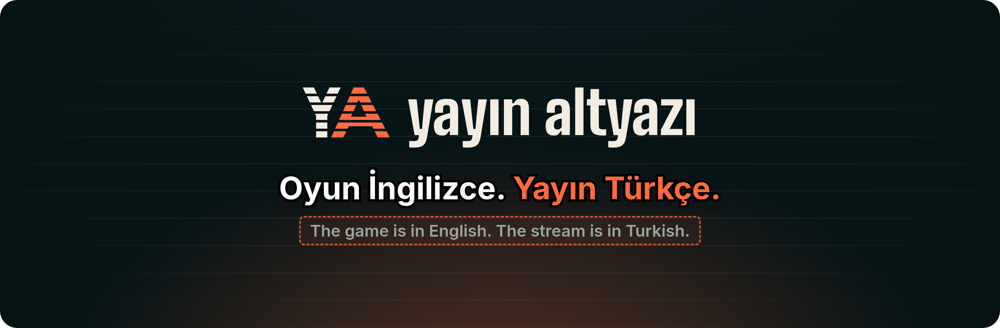
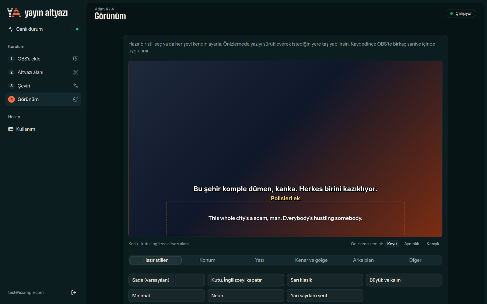
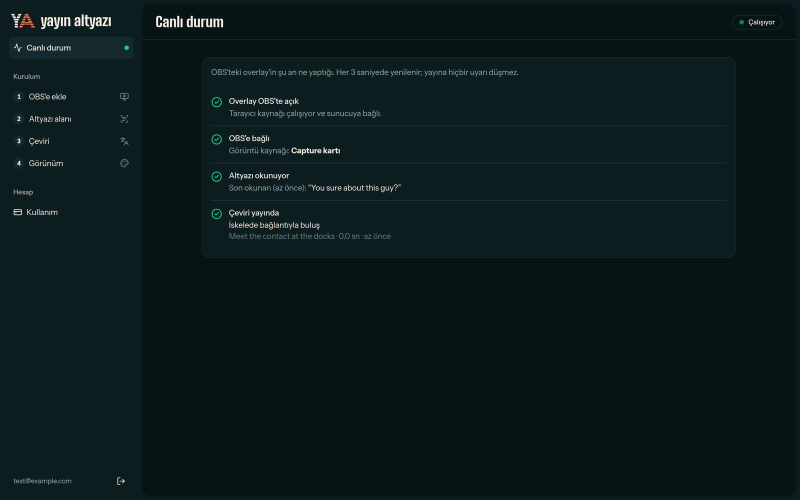
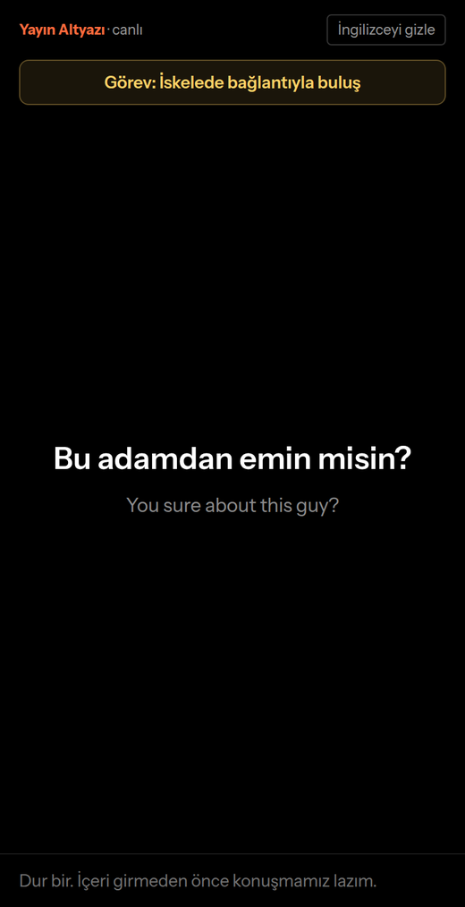
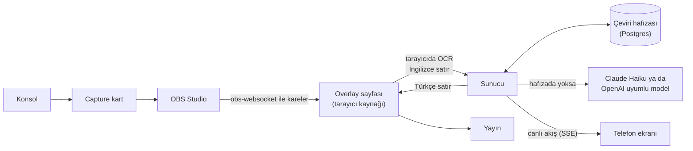

<div align="center">



<h3>Konsol yayınlarına canlı Türkçe altyazı</h3>

<p>Oyundaki İngilizce altyazıyı capture karttan okuyup<br />genelde bir saniye içinde doğal Türkçesini yayına koyan OBS overlay'i.</p>

<p>
  <a href="LICENSE"></a>
  
  
  
  
</p>

<p>
  <a href="README.md">English</a> · <b>Türkçe</b>
</p>

<p>
  <a href="https://altyazi.ordinon.com"><b>Barındırılan sürüm</b></a> ·
  <a href="#özellikler">Özellikler</a> ·
  <a href="#nasıl-çalışır">Nasıl çalışır</a> ·
  <a href="#hızlı-başlangıç">Hızlı başlangıç</a> ·
  <a href="#sunucuya-kurulum">Sunucuya kurulum</a> ·
  <a href="#ayarlar">Ayarlar</a> ·
  <a href="#sık-sorulanlar">SSS</a>
</p>

</div>

<br />

<p align="center">
  
</p>

## Neden

Büyük oyunlar Türkçe dil desteği olmadan çıkıyor, konsoldan yayın yapanlar da mod ya da yama kuramıyor. Yayın Altyazı sadece görüntüyle çalışır. Oyunun zaten ekrana çizdiği İngilizce altyazıyı okur, sahnenin geri kalanını bağlam olarak kullanıp çevirir ve Türkçe satırı OBS'te oyunun üstüne çizer. Konsola da oyuna da dokunmaz.

GTA 6 ile başladı ve onun için hazır bir sözlükle gelir. İngilizce altyazı gösteren her oyunda çalışır.

## Barındırılan sürüm

Sunucu kurmakla uğraşmak istemiyor musun? **[altyazi.ordinon.com](https://altyazi.ordinon.com)** barındırılan sürüm; ücretsiz denemeyle hemen kullanabilirsin. Kayıt ol, overlay adresini OBS'e yapıştır ve yayına çık. Bu depo aynı projenin açık kodu: okumak, kendi sunucunda çalıştırmak ya da katkı vermek isteyenler için.

## Özellikler

<table>
  <tr>
    <td width="50%" valign="top">
      <h4>Görüntü bilgisayarında kalır</h4>
      Tesseract, OBS'in tarayıcı kaynağında WebAssembly olarak çalışır. Sunucuya sadece okunan İngilizce metin gider.
    </td>
    <td width="50%" valign="top">
      <h4>Diyalog ve görev yazısı ayrı</h4>
      Okuyucu, diyaloğu altındaki görev yazısından ayırır. İkisi de yayında kendi satırında, kendi renginde ve boyutunda görünür.
    </td>
  </tr>
  <tr>
    <td valign="top">
      <h4>Bağlamı bilen çeviri</h4>
      Her satır, sahnedeki son birkaç satırla birlikte modele gider; zamirler, argo ve iç espriler doğru çıkar. Oyun sözlüğü isimleri olduğu gibi bırakır.
    </td>
    <td valign="top">
      <h4>Ortak çeviri hafızası</h4>
      Çevrilen satır bir kez kaydedilir, sonra herkese anında gelir. Trigram eşleştirme (<code>pg_trgm</code>) hafızadaki satırların OCR hatalı okumalarını da yakalar.
    </td>
  </tr>
  <tr>
    <td valign="top">
      <h4>Tam stil kontrolü</h4>
      Yazı tipi, boyut, renk, kontur, gölge, kutu ve konum; hazır stiller ve canlı önizlemeyle. "İngilizcenin üstüne (kapat)" konumu, İngilizce yazının tam üstüne opak bir kutu çizer.
    </td>
    <td valign="top">
      <h4>Telefon ve ikinci ekran</h4>
      Ayrı bir bağlantı (QR koduyla) Türkçe satırları telefonda, tablette ya da bir OBS dock'unda canlı gösterir. Yayıncı TV'ye bakarken altyazıyı takip edebilir.
    </td>
  </tr>
  <tr>
    <td valign="top">
      <h4>Panelde canlı durum</h4>
      Overlay açık mı, OBS bağlı mı, OCR en son ne okudu, en son ne çevrildi; hepsi panelde. Sorunlar orada görünür, yayına asla düşmez.
    </td>
    <td valign="top">
      <h4>Model de sunucu da senin</h4>
      Varsayılan olarak Claude Haiku, istersen OpenAI uyumlu herhangi bir API, yerel modeller dahil. Tek Docker imajı, Postgres ya da gömülü PGlite.
    </td>
  </tr>
</table>

<table>
  <tr>
    <td width="72%"></td>
    <td width="28%"></td>
  </tr>
  <tr>
    <td align="center"><sub>Paneldeki canlı durum</sub></td>
    <td align="center"><sub>Telefon ekranı</sub></td>
  </tr>
</table>

## Nasıl çalışır



1. Yayıncı paneli açar, capture kaynağını seçer ve altyazının çıktığı alanı işaretler.
2. Overlay sayfası (`/o/<token>`) OBS'te tarayıcı kaynağı olarak çalışır. OBS'in yerleşik obs-websocket sunucusuna `ws://127.0.0.1:4455` üzerinden bağlanır ve capture kaynağından kare alır.
3. Okuyucu, altyazı alanındaki açık renkli yazıyı bulur, gerçek parlaklığını ölçer ve Tesseract ile okur. Satır ilk okunduğu anda gönderilir, sonraki karelerde doğrulanır; böylece çeviri erken başlar.
4. Sunucu önce hafızaya bakar, yoksa sahnenin önceki satırlarıyla birlikte modele sorar. Her cevabı kontrol eder; çeviri yerine yorum yapan cevabı atar.
5. Overlay, Türkçe satırı seçilen stilde çizer. Telefon ekranına da aynı anda gider.

## Hızlı başlangıç

**Node.js 24** ve **pnpm 11** gerekir. Bir de Anthropic API anahtarı ya da OpenAI uyumlu herhangi bir API.

```sh
git clone https://github.com/berkay-digital/yayin-altyazi.git
cd yayin-altyazi
pnpm install
cp .env.example .env
```

`.env` içinde `BETTER_AUTH_SECRET` (`openssl rand -base64 32`) ve `ANTHROPIC_API_KEY` değerlerini doldur. Başka bir model kullanacaksan bunun yerine `AI_BASE_URL`, `AI_API_KEY` ve `AI_MODEL` değerlerini gir.

```sh
pnpm dev
```

http://localhost:3000 adresini aç, hesap oluştur ve paneldeki dört kurulum adımını izle. Geliştirme ortamı `.data/pglite` içinde PGlite (gömülü Postgres) kullanır, veritabanı kurmana gerek yok. Migration'lar açılışta çalışır.

### OBS kurulumu

1. OBS'te **Araçlar → WebSocket Sunucu Ayarları**'nı aç ve sunucuyu etkinleştir.
2. Panelde **OBS'e ekle** adımındaki overlay adresini kopyala ve sahnene 1920 × 1080 boyutunda bir **Tarayıcı** kaynağı olarak, oyunun üstüne ekle.
3. **Altyazı alanı** adımında WebSocket şifresini gir, capture kartını ya da oyun girişini seç (sahne seçme) ve altyazıyı çevreleyen kutuyu kontrol et.
4. Oyunda İngilizce altyazıyı aç. **Canlı durum** sayfasında her adım yeşile döner.

Yayıncının OBS Studio 28 ya da üstüne ve bir capture karta ihtiyacı var. Streamlabs desteklenmiyor.

## Sunucuya kurulum

Dockerfile, 3000 portunu dinleyen bir Node sunucusu (Nitro `node-server` çıktısı) üretir.

```sh
docker build -t yayin-altyazi .
docker run -d -p 3000:3000 --env-file .env yayin-altyazi
```

Canlı ortam için:

- `DATABASE_URL` ile Postgres'i göster. Migration'lar `pg_trgm` eklentisini oluşturur, veritabanı kullanıcısının buna izni olmalı. `DATABASE_URL` yoksa container `/app/.data/pglite` içinde PGlite kullanır; o yolu seçersen oraya bir volume bağla.
- `BETTER_AUTH_URL` değerini herkese açık https adresine ayarla. OBS'in tarayıcısı https sayfadan da `ws://127.0.0.1` adresine ulaşabilir.
- Kendi hesabını açtıktan sonra `SIGNUP=closed` yap. Her hesap senin API anahtarını harcayabilir.
- Cloudflare arkasındaysan `CLIENT_IP_HEADER=cf-connecting-ip` ayarla, böylece istek sınırları gerçek istemci adresini görür.

`/api/health`, veritabanı cevap veriyor ve çeviri servisi hazırsa 200 döner.

> [!NOTE]
> Normal Chrome, bir sitenin `127.0.0.1` adresine erişmesinden önce izin ister. Panel OBS'i göremiyorsa site için yerel ağ erişimine izin ver ya da paneli OBS'te özel dock olarak aç.

## Ayarlar

Tüm ayarlar ortam değişkenleriyle yapılır. [`.env.example`](.env.example) hepsini açıklamalarıyla listeler.

| Değişken | Gerekli | Ne yapar |
| --- | --- | --- |
| `BETTER_AUTH_SECRET` | evet | Oturumları imzalar. 32+ karakterlik rastgele bir metin. |
| `BETTER_AUTH_URL` | evet | Uygulamanın herkese açık adresi. |
| `ANTHROPIC_API_KEY` | biri | Çeviri için Claude anahtarı. |
| `ANTHROPIC_API_KEY_PRIMARY` | | Önce kullanılan ikinci anahtar. İstek sınırına takılınca ya da kredisi bitince `ANTHROPIC_API_KEY` devralır. |
| `CLAUDE_MODEL` | | Varsayılan `claude-haiku-5-5`. |
| `AI_BASE_URL` `AI_API_KEY` `AI_MODEL` | biri | OpenAI uyumlu API; Anthropic anahtarı yoksa kullanılır. Yerel sunucular da olur. |
| `AI_EXTRA_BODY` | | Her isteğin gövdesine eklenen JSON, örneğin `{"temperature":0.2}`. |
| `DATABASE_URL` | canlıda | Postgres. Boşsa `PGLITE_DIR` içinde PGlite (varsayılan `.data/pglite`). |
| `SIGNUP` | | `closed` yeni hesap açılmasını kapatır. |
| `CLIENT_IP_HEADER` | | Proxy'nin istemci adresini koyduğu başlık. Varsayılan `X-Forwarded-For`. |
| `TURNSTILE_SITE_KEY` `TURNSTILE_SECRET_KEY` | | Kayıt ve girişte Cloudflare Turnstile. |
| `SUPPORT_EMAIL` | | Giriş sayfasında şifre sıfırlama için gösterilir. Uygulama e-posta göndermez. |

<details>
<summary><b>İsteğe bağlı ödeme (Polar)</b></summary>
<br />

Ödeme varsayılan olarak kapalıdır ve her hesap sınırsız çeviri yapar. Barındırdığın sunucu için ücret almak istersen [Polar](https://polar.sh)'da aylık bir ürün oluştur ve şunları ayarla:

| Değişken | Ne yapar |
| --- | --- |
| `POLAR_ACCESS_TOKEN` | Polar API anahtarı. Bu ve `POLAR_PRODUCT` ayarlıysa ödeme açılır. |
| `POLAR_PRODUCT` | Aylık paketin ürün kimliği. |
| `POLAR_WEBHOOK_SECRET` | Webhook gizli anahtarı. Webhook'u `subscription.*` olaylarıyla `/api/auth/polar/webhooks` adresine yönlendir. |
| `POLAR_ENV` | Gerçek ödemeler için `production`. Varsayılan `sandbox`. |
| `PLAN_NAME` `PLAN_PRICE` | Panelde görünenler, örneğin `Aylık` ve `₺99/ay`. |
| `TRIAL_MINUTES` | Ücretsiz deneme süresi. Varsayılan 180. |
| `FAIR_USE_MINUTES` | Ücretli paketin aylık sınırı. Varsayılan 15000. |

Kullanım aktif dakikayla ölçülür: bir dakika sadece içinde en az bir satır yayına çıktıysa sayılır. Menüde beklemek, araba sürmek ya da sohbet etmek süreden yemez.

</details>

## Geliştirme

```sh
pnpm dev          # http://localhost:3000
pnpm typecheck
pnpm lint
pnpm build
pnpm test:e2e     # derler, sonra uçtan uca testleri çalıştırır
```

Şema değişikliğinden sonra `pnpm drizzle-kit generate --name <isim>` çalıştır. `/dev/engine` bir OCR test sayfasıdır: bir video ya da ekran görüntüsü yükle, okuyucunun ne gördüğüne bak.

```
src/
├── engine/        tarayıcıda OCR: kare kaynakları, ön işleme, Tesseract, SubtitleReader
├── server/        hesaplar, çeviri ve hafıza, kullanım ölçümü, canlı akış, sözlükler
├── routes/        tanıtım sayfası, giriş, panel, overlay (/o/$token), telefon (/v/$viewToken), API
├── components/    panel, overlay ve tanıtım arayüzü (Base UI üstünde shadcn/ui)
└── shared/        tarayıcı ve sunucunun ortak kullandığı ayar şeması
scripts/
├── ocr-bench/     gerçek oyun görüntüsüyle OCR ölçümü
├── prefill/       hafızayı bir oyun videosundan önceden doldurur
└── eval-models.ts çeviri modellerini karşılaştırır
tests/             uçtan uca testler (e2e), test videosu ve test sunucusu
drizzle/           SQL migration'ları, açılışta uygulanır
```

[TanStack Start](https://tanstack.com/start), [React 19](https://react.dev), [Tailwind CSS 4](https://tailwindcss.com), [shadcn/ui](https://ui.shadcn.com), [Better Auth](https://better-auth.com), [Drizzle](https://orm.drizzle.team), [Tesseract.js](https://tesseract.projectnaptha.com) ve [obs-websocket-js](https://github.com/obs-websocket-community-projects/obs-websocket-js) ile yapıldı.

### Uçtan uca testler

[`tests/`](tests) içindeki testler [e2e](https://e2e.com) ile (altında Playwright) canlı ortam derlemesine karşı çalışır. [`tests/support/serve.mts`](tests/support/serve.mts) uygulamayı boş bir portta, geçici bir veritabanı ve sahte bir çeviri modeliyle başlatır; API anahtarı gerekmez, ücretli bir modele asla istek gitmez. Kapsadıkları:

- tanıtım sayfası, kayıt, giriş ve çıkış
- paneldeki kurulum adımları, stil kaydetme ve overlay adreslerini yenileme
- satır API'si, çeviri hafızası ve erken okumalar
- altyazının bütün yolu: overlay [`tests/fixtures/subtitles.webm`](tests/fixtures) videosunu (uydurma İngilizce satırlar) tarayıcıda OCR ile okur, Türkçe satır overlay'de, telefon ekranında ve canlı durumda görünür

```sh
pnpm test:e2e                          # derle ve hepsini çalıştır
pnpm exec e2e run tests/panel.e2e.ts   # tek dosya, son derlemeye karşı
pnpm exec e2e run --headed             # tarayıcıyı izle
```

İlk çalıştırma Chromium'u indirir. Başarısız testler `.e2e/results/` içinde ekran görüntülü bir iz bırakır. CI, testleri her push ve pull request'te çalıştırır ([`.github/workflows/ci.yml`](.github/workflows/ci.yml)).

#### Yapay zekâ ajanı testleri

[`tests/agent.e2e.ts`](tests/agent.e2e.ts), e2e'nin yapay zekâ ajanını kullanır. Adımlar düz İngilizce yazılır, ajan Türkçe paneli kendisi çözer:

```ts
await agent.act(
  "Open the appearance settings. Make the subtitles cover the English subtitle, use a large font size, " +
    "make the text bold and yellow, then save the changes.",
)
// Kesin kontroller ajanın yaptığını doğrular: overlay artık büyük, sarı ve İngilizceyi kapatan bir stil yükler.
expect(settings.style.placement).toBe("cover")
```

- **İşi ajan yapar.** "Görünüm" adımını, "Konum" ve "Yazı" sekmelerini, "İngilizcenin üstüne (kapat)" seçeneğini ve renk alanını isimleri söylenmeden bulur. Başka bir test, adres sızdıktan sonra ondan "eski overlay adresi çalışmasın diye yeni adresler oluşturmasını" ister.
- **Bir kez kaydedilir, sonra tekrar oynatılır.** İlk çalıştırma 13 saniye ve bir model çağrısı sürdü. e2e doğrulanmış adımları [`tests/e2e-cache/`](tests/e2e-cache) içine kaydeder; sonraki her çalıştırma bunları modelsiz, yaklaşık 1,4 saniyede tekrar oynatır. CI kayıtları `--strict-cache` ile oynatır; arayüz değişip bir kayıt artık uymazsa model çağırmak yerine derleme başarısız olur.
- **Çıktıyı yapay zekâ hakemi kontrol eder.** `agent.assert` overlay'i ve telefon ekranını okuyup Türkçe satırın İngilizcenin doğru bir çevirisi olduğunu kontrol eder. Bir kontrol testi, Türkçe satırı alakasız bir cümleyle değiştirir ve hakemin bunu reddetmesini bekler. Hakem her seferinde modeli çağırdığı için bu testler CI'da atlanır.

Ajan, `@e2e-dev/acp` üzerinden Claude Code ile çalışır ve senin `claude` girişini kullanır; ayarlanacak bir API anahtarı yoktur. [e2e'nin desteklediği](https://e2e.com/docs/models) herhangi bir model, [`e2e.config.ts`](e2e.config.ts) içindeki `agents` değiştirilerek kullanılabilir.

```sh
pnpm exec e2e run --tag agent              # sadece ajan testleri
pnpm exec e2e run --tag agent --no-cache   # ajan her adımı yeniden canlı yapsın
```

### Oyun eklemek

Sözlükler [`src/server/glossary/`](src/server/glossary) içinde. Sözlük, prompt'a giden bağlamdır: olduğu gibi kalacak isimler ve yerler, argo ve konuşma tonu. Oyunu [`src/shared/settings.ts`](src/shared/settings.ts) içindeki `GAMES` listesine ve `game` seçeneklerine ekle, sonra [`src/server/llm.ts`](src/server/llm.ts) içinde bağlamını seç.

### OCR ölçümü ve hafızayı önceden doldurma

`src/engine/` içinde bir şey değiştirmeden önce ve sonra OCR ölçümünü çalıştır. Prefill script'leri gerçek okuyucuyu bir oyun videosu üzerinde çalıştırır ve her satırı dolar bütçesiyle önceden çevirir; yayınlar dolu bir hafızayla başlar. İkisi de telif hakkı olan oyun görüntüsü ve metniyle çalıştığı için bu dosyalar git'e girmez. Her script'in başındaki açıklama hangi yerel dosyaları beklediğini yazar.

## Sık sorulanlar

<details>
<summary><b>Oyun görüntüm bilgisayarımdan çıkıyor mu?</b></summary>
<br />
Hayır. OCR, OBS'in içinde çalışır. Sunucuya sadece okunan İngilizce satır gider.
</details>

<details>
<summary><b>Ne kadar hızlı?</b></summary>
<br />
Hafızada olan satırlar anında gelir. Yeni satırlar Claude Haiku ile genelde bir saniyenin altında ekranda olur. Overlay çeviriyi satırın ilk okunuşunda başlatır, sonraki karelerde doğrular; model çağrısının çoğu bu bekleme süresine denk gelir.
</details>

<details>
<summary><b>OBS'te hangi kaynağı seçmeliyim?</b></summary>
<br />
Capture kartını ya da oyun girişini. Asla sahne seçme: sahne overlay'i de içerdiği için kendi Türkçesini okur. Sahne seçersen panel uyarır.
</details>

<details>
<summary><b>Yerel bir model kullanabilir miyim?</b></summary>
<br />
Evet. <code>AI_BASE_URL</code> değerini OpenAI uyumlu herhangi bir sunucuya (Ollama, LM Studio, vLLM) yönlendir, Anthropic anahtarlarını boş bırak. Kalite, modelin Türkçesine bağlı.
</details>

<details>
<summary><b>Çalıştırmanın maliyeti ne?</b></summary>
<br />
Sadece model çağrıları. Altyazı satırları kısa, tekrar eden satırlar hafızadan gelir; Claude Haiku ile bir akşamlık yayın birkaç sente mal olur.
</details>

## Katkı

Issue ve pull request'lere açığız. PR açmadan önce `pnpm typecheck`, `pnpm lint` ve `pnpm test:e2e` çalıştır; `src/engine/` içinde değişiklik yaptıysan OCR ölçümünü de. Lütfen oyun videosu, kare ya da oyun diyaloğu commit'leme.

## Markalar

Grand Theft Auto ve GTA, Take-Two Interactive Software, Inc.'in markalarıdır. Bu proje bağımsızdır; Rockstar Games veya Take-Two ile bağlantısı yoktur ve onlar tarafından onaylanmamıştır. Oyuna ya da dosyalarına dokunmaz, yayıncının zaten yakaladığı görüntüdeki yazıyı okur.

## Lisans

[MIT](LICENSE)
